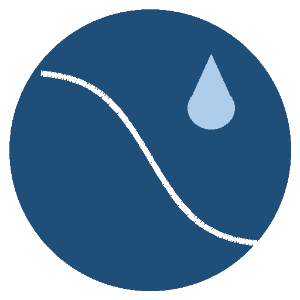

# SWRC/HCC Fitter

### Fit soil water‑retention & hydraulic‑conductivity curves — beautifully, and fast.

A native application for **soil hydraulic property** estimation across the full
moisture range: **96 retention models × 6 conductivity models**, three fit
objectives, two kinds of uncertainty, model ranking with Akaike weights, and a
clean lab‑style interface — on **Windows and Linux**.

&nbsp;

<b>▶ Try it in your browser — no install: <a href="https://PTF.bluerror.com/">PTF.bluerror.com</a></b>

<b>📖 User manual with worked examples: <a href="https://bluerror.com/manual.html">bluerror.com/manual.html</a></b>

---

## 🆕 3.0.2 — better fits

- **More reliable optimisation.** Scale parameters (α, hm, Ks, Ksnc, K(hₐ) …) span several decades, and the
  previous linear search almost never sampled small values — fine-textured soils with a high air-entry
  suction could end in a false optimum (e.g. a HYPROP sample where Brunswick vG gave θ NSE 0.85 instead of 0.994).
  Every fit now also searches these parameters on a log scale and keeps the better result, so a fit is
  never worse than before. On 100 database soils, 73–91 % of fits improved, many by more than 2×.
- **Exports in the desktop app** (report, CSV, figures, session) are written by the app through the Save dialog,
  so repeated exports are never blocked.

## 🆕 3.0.1

- **Fits any screen** — the whole window scales to your monitor, laptop, tablet or phone (up to 4K); nothing scrolls and no browser zoom is needed. Plots are always square and sized to the free space.
- **Calm, steady interface** — the panes keep their size while you work (ticking NLL, learner mode or another model changes nothing else on screen), results update in place after a fit, and nothing moves when you hover or click.
- **One-click example data** — picking a soil from *“No data? Try a database”* loads it straight away.
- Plot text, lines and legend scale with the plot size, so small and very large screens both stay readable.

## ⚡ What's new in 3.0

Version 3 replaces the Python/Dash engine with a **native Fortran kernel (OpenMP)** driven by a
**C# (.NET 8)** engine. Same interface, same results format — much faster, and it now runs on Linux.

| Task (same data and settings) | 1.x (Python) | 3.0 (native) |
|---|---|---|
| 4 models, no bootstrap | 8.3 s | **0.12 s** |
| 4 models + bootstrap | 36.6 s (10 refits) | **1.7 s (50 refits)** |
| Batch fit, 329 soils | minutes | **≈ 2 s** |

Every model and every bootstrap refit runs in parallel; the differential‑evolution population is
evaluated with OpenMP. Results are deterministic — identical on Windows and Linux.

---

## ✨ Highlights

- 🧮 **96 retention models** — 8 basic functions × {uni·bi·tri‑modal} × 4 full‑range variants (original · Brunswick · PDI · Wang)
- 💧 **6 conductivity models** — Mualem / Burdine / Alexander–Skaggs / Childs–Collis‑George + Gardner exponential & power; tick several to compare
- 🧾 **Equations on hover** — point at any model in the matrix to see its θ(h), K(h) and conductivity model in rendered LaTeX
- 🎯 **Three fit objectives** — **nRMSE**, **NSE**, or Gaussian **NLL** (puts θ and K on one scale)
- 📈 **Two uncertainty modes** — **bootstrap** CIs / confidence + prediction bands, *or* **likelihood (NLL)** uncertainty with calibrated or user‑given σ
- 🏆 **Model ranking** — NSE (colour‑graded), **ΔAICc and Akaike weights** for every compared model; parameters stuck at a search bound are flagged
- 🌈 **Model comparison** — `Ctrl`+click models to overlay; each curve has its own colour and matching 95 % band
- 📊 **Statistical analysis** — RMSE · NSE · KGE · NLL per branch, AICc, σ, water content & plant‑available water with CIs, residual normality (Shapiro–Wilk)
- 📄 **PDF report** — dashboard KPIs, colour‑graded leaderboard, θ(h)/K(h)/K(θ) plots, comparison bars, recommended‑model breakdown
- 🌫️ **Isothermal vapor conductivity** — optional dry‑range K floor (Saito, Šimůnek & Mohanty 2006)
- 🏷️ **Soil‑water zones on every plot** — gravitational / plant‑available / hygroscopic water and the characteristic suctions
- 🔬 **Capacity C(h), pore‑size distribution and residual plots**
- 🗂️ **Built‑in example databases** — no data of your own? Load a measured soil from **Hohenbrink et al. (2023)** (569 soils), **UNSODA 2.0** (329) or **EU‑HYDI** (2243) via *“No data? Try a database”*
- 📂 **Smart loading** — CSV, text or Excel; auto‑detects delimiter, decimal mark, sheet and table start; **drag & drop** anywhere; a data check warns about wrong units
- 🔤 **Flexible input units** — suction in pF / cm / kPa / hPa, K in cm·d⁻¹ / cm·s⁻¹ / mm·h⁻¹ / m·s⁻¹
- 🎓 **Learner mode** — USDA texture presets and live curve preview
- ⏱️ **Fast & cancellable** — live progress with time remaining; `Esc` cancels
- ⌨️ **Shortcuts** — `Ctrl+Enter` fit · `Ctrl+O` open · `Ctrl+S` save session · `Ctrl+P` report
- 💾 **Sessions** — save/restore a fit as JSON (sessions from 1.x open too); your settings are remembered
- 🖥️ **One‑window layout** — everything fits on one screen at any size, from phone to 4K, with no scrolling

---

## 🚀 Install — one file per platform

Download from the **[latest release](../../releases/latest)**:

| Platform | File | How |
|---|---|---|
| **Windows** 10/11 (x64) | `SWRC-HCC-Fitter-3.0.2-setup.exe` | Double‑click and follow the wizard. Everything is included — nothing is downloaded, no Python or .NET needed. Upgrades an existing 1.x installation. |
| **Linux** (x64) | `SWRC-HCC-Fitter-3.0.2-linux-x64.run` | `chmod +x SWRC-HCC-Fitter-3.0.2-linux-x64.run && ./SWRC-HCC-Fitter-3.0.2-linux-x64.run` |

**Linux notes**
- Run the installer as a normal user to install into `~/.local`, or with `sudo` for a system‑wide install in `/opt`.
- Start it from your application menu or with `swrc-hcc-fitter` — the interface opens in your browser.
- The kernel uses the system libraries `libgfortran5` and `libgomp1` (installed automatically with `sudo`).
- **Host the web version** yourself: `sudo systemctl enable --now swrc-hcc-fitter` serves it on port 8050 (put nginx/Caddy with TLS in front).
- Remove with `./SWRC-HCC-Fitter-3.0.2-linux-x64.run --uninstall`.

---

## 🌱 Retention models

**8 basic functions × 3 pore‑system modes (unimodal · bimodal · trimodal) × 4 full‑range variants = 96 retention models.**

| Variant | Reference | Non‑capillary / dry‑end treatment |
|---|---|---|
| **original**  | classic capillary | none (flattens to θr); Fredlund–Xing includes its C(ψ) correction |
| **Brunswick** | Weber et al. 2019 *(WRR)* | integral‑derived non‑capillary saturation + film conductivity |
| **PDI**       | Peters, Durner & Iden 2024 *(VZJ)* | smoothed piecewise‑linear `S_nc`, air‑entry from `S_c`, 6 cm max‑pore‑size cutoff |
| **Wang**      | Wang, Ma & Vereecken 2025 *(WRR)* | `θ = C(h)[(θs−θr)Γ + θr]`; nc > 1 gives bimodal curves; K matched at h_a = 6 cm + film term |

> Basic functions: **van Genuchten** (m = 1−1/n) · **van Genuchten** (m, n free) ·
> **van Genuchten (Vogel–Císlerová** air‑entry, 1988**)** · **Brooks–Corey** (1964) ·
> **Campbell** (1974) · **Kosugi** (1996) · **Fredlund–Xing** (constrained & m‑free).

The formulations were checked against the source papers. Defaults follow the papers; the
*Model options* panel can apply the 6 cm pore cutoff to every variant (this reproduces the 1.x
results) and switch the Brunswick film base to h₀/hₐ (Peters & Iden 2021).

## 💧 Conductivity models

| Model | Reference | Form |
|---|---|---|
| **Mualem** ⭐ | Mualem 1976 | `q=1, r=2`, τ default 0.5 *(recommended)* |
| **Burdine** | Burdine 1953 | `q=2, r=1`, τ default 2 |
| **Alexander–Skaggs** | Alexander & Skaggs 1986 | `q=1, r=1`, τ default 1 |
| **Childs–Collis‑George** | Childs & Collis‑George 1950 | moment integral, τ default 4/3 |
| **Gardner (exponential)** | Gardner 1958 | `K = Ks·exp(−kg·h)` |
| **Gardner (power)** | Gardner 1958 | `K = Ks/[1+(h/hk)^pk]` |

τ defaults follow Peters, Iden & Durner (2023, *HESS*).

---

## 🎯 Fit objective & uncertainty

| Objective | What it does | Uncertainty |
|---|---|---|
| **nRMSE** | range‑normalised RMSE, so θ and K weigh equally | bootstrap |
| **NSE**   | variance‑normalised (Nash–Sutcliffe) | bootstrap |
| **NLL**   | Gaussian negative log‑likelihood; jointly calibrates the mean and noise **σ** | likelihood band |

Reported per branch: **RMSE · NSE · KGE · NLL**, plus **AICc / ΔAICc / Akaike weight** for model
selection and water‑content / plant‑available‑water summaries at standard suctions.

---

## 📂 Data format

CSV, text or Excel — one combined file **or** separate retention/conductivity files. Columns are
auto‑mapped (`pF`, `θ`, `pF` for K, `K`, optional `sample_id`) and can be changed in the toolbar.
A sample may have only SWRC or only HCC data. Hover any **ⓘ** for in‑app help.

---

## 📝 Citation

> Shojaeezadeh, S.A. *SWRC/HCC Fitter tool for fitting soil water retention and hydraulic conductivity curves over the full moisture range* (under review).

**If you use a built‑in example database, please also cite it:**

- Hohenbrink, T., Jackisch, C., Durner, W., Germer, K., Iden, S., Kreiselmeier, J., et al. (2023). Soil water retention and hydraulic conductivity measured in a wide saturation range. *Earth System Science Data*, 15, 4417–4432. <https://doi.org/10.5194/essd-15-4417-2023>
- Nemes, A., Schaap, M. G., Leij, F. J., & Wösten, J. H. M. (2001). Description of the unsaturated soil hydraulic database UNSODA version 2.0. *Journal of Hydrology*, 251(3–4), 151–162. <https://doi.org/10.1016/S0022-1694(01)00465-6>
- Weynants, M., Montanarella, L., Tóth, G., et al. (2013). *European Hydropedological Data Inventory (EU‑HYDI)*. Publications Office of the European Union. <https://doi.org/10.2788/5936>

## 📜 References

- **Weber, Durner, Streck & Diamantopoulos (2019)**, *WRR* 55:4994 — Brunswick framework. <https://doi.org/10.1029/2018WR024584>
- **Peters & Iden (2021)** comment and **Weber et al. (2025)** reply, *WRR* — Brunswick film conductivity.
- **Peters, Durner & Iden (2024)**, *VZJ* 23:e20338 — the PDI model system. <https://doi.org/10.1002/vzj2.20338>
- **Wang, Ma & Vereecken (2025)**, *WRR* — generalized framework for unimodal and bimodal soil hydraulic properties.
- **Peters, Iden & Durner (2023)**, *HESS* 27:4579 — capillary‑bundle conductivity models. <https://doi.org/10.5194/hess-27-4579-2023>
- **Saito, Šimůnek & Mohanty (2006)**, *VZJ* — isothermal vapor conductivity.

## 🔗 Links

- 👤 **GitHub — [Bluerrror](https://github.com/Bluerrror)**
- 🎓 **[Soil Science Section, University of Kassel](https://www.uni-kassel.de/fb11agrar/en/fachgebiete-einrichtungen/bodenkunde/home.html)**

Released under the **MIT License** — see [LICENSE](LICENSE).
